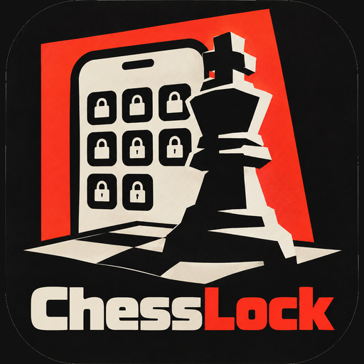

<p align="center"></p>

# ChessLock

An Android app that locks the apps that waste your time (Instagram, YouTube, Facebook, TikTok, or any app you choose). To open one, you have to solve a chess puzzle first.

## How it works

1. An accessibility service notices when a locked app opens.
2. ChessLock covers it with a chess puzzle.
3. Solve it and the app opens. Fail it, or press back, and you go to the home screen.

You choose how often it asks:

- **Every time I open a locked app.** The app locks again as soon as you leave it.
- **Once, then unlock for a while.** Stays unlocked for 5 to 60 minutes.

The service only reads which app is in the foreground. It does not read screen content.

## Get the APK

**With GitHub Actions (no setup needed):**

1. Open the **Actions** tab of this repository and pick the latest successful "Build APK" run.
2. Download **ChessLock-debug-apk** from the Artifacts section and unzip it.
3. Copy `app-debug.apk` to your phone and install it (allow "Install unknown apps" if asked).

**With Android Studio:** open the project, wait for Gradle to sync, then choose Build > Build APK(s). The APK ends up in `app/build/outputs/apk/debug/`.

## First-time setup on the phone

1. Open ChessLock and tap **Turn on in Accessibility**, then enable ChessLock Guard.
2. On Android 13 and newer, if the switch is greyed out: Settings > Apps > ChessLock > three-dot menu > **Allow restricted settings**, then try again.
3. Pick the apps to lock and choose when to ask for a puzzle.

Some phone brands stop background services to save battery. If the lock stops working, exempt ChessLock from battery optimization.

## Adding more puzzles

The app reads puzzles from `app/src/main/assets/puzzles.txt`. Without that file it uses 3 built-in puzzles.

Each line is `FEN|moves|rating` in the Lichess puzzle format. The first move is the opponent's, then the moves alternate:

```
6k1/p4ppp/8/8/8/8/5PPP/3Q2K1 b - - 0 1|a7a6 d1d8|800
```

To import thousands from the Lichess puzzle database:

```
pip install zstandard
python tools/make_puzzles.py lichess_db_puzzle.csv.zst 3000 600 1600
```

The arguments are the file, how many puzzles to pick, and the minimum and maximum rating. Download the database from https://database.lichess.org/#puzzles, then commit the generated `puzzles.txt`.

## Project layout

```
app/src/main/java/app/chesslock/
  ChessLockService.kt   detects locked apps
  PuzzleActivity.kt     puzzle screen and solving logic
  MainActivity.kt       settings screen
  Prefs.kt              saved settings and unlock state
  Puzzles.kt            puzzle loading
  ui/                   neo-brutalist theme and the chessboard
tools/make_puzzles.py   Lichess puzzle importer
.github/workflows/      builds the APK
```

Built with Kotlin, Jetpack Compose and [chesslib](https://github.com/bhlangonijr/chesslib).

## Limitations

- Anyone can turn the lock off in Accessibility settings or uninstall the app, so it is meant to add friction, not to be unbypassable.
- The accessibility approach may not be accepted on the Play Store, so this is meant to be sideloaded.

## Credits

- Chess pieces: the "cburnett" set by Colin M.L. Burnett, via Lichess (GPLv2+).
- Puzzles: the Lichess puzzle database (CC0).
